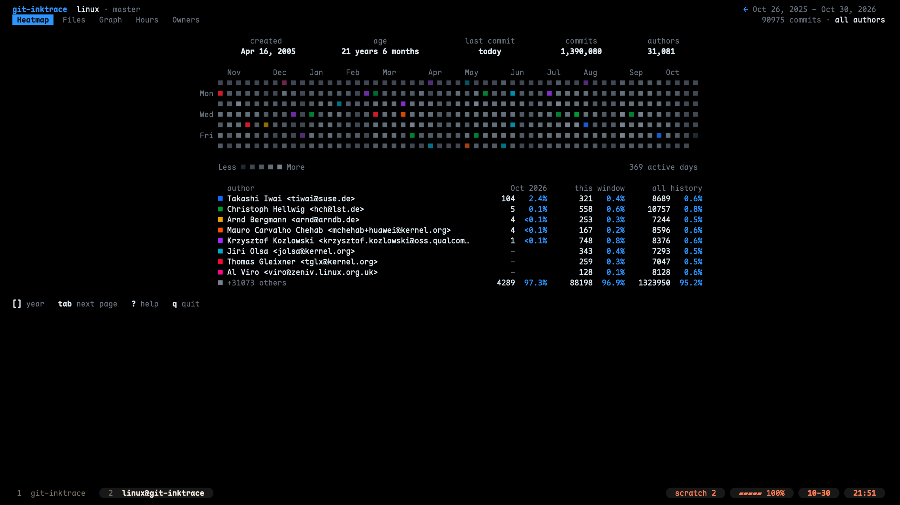
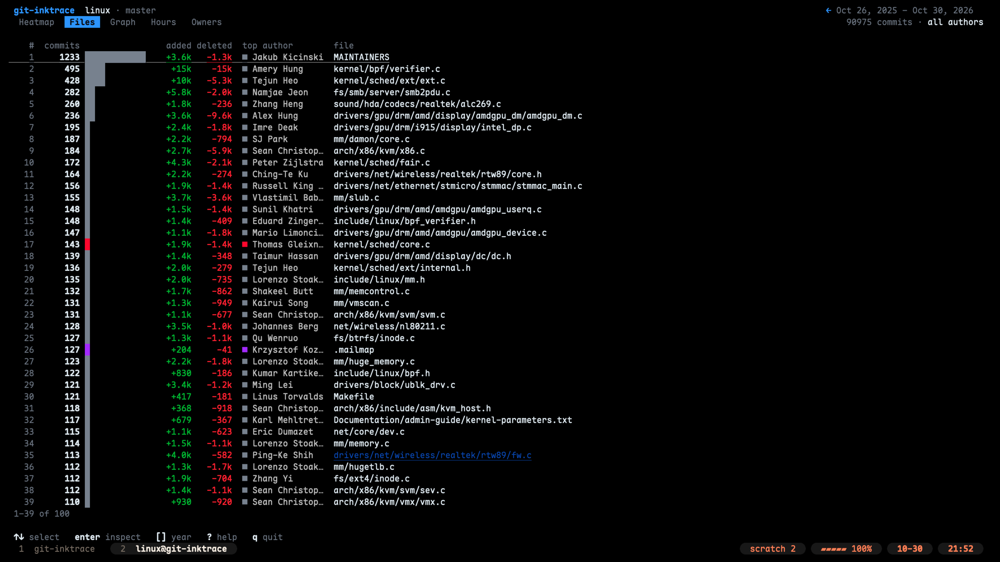
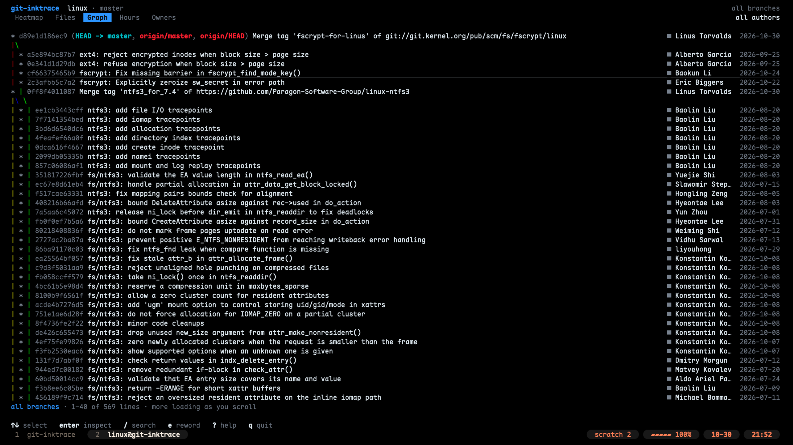
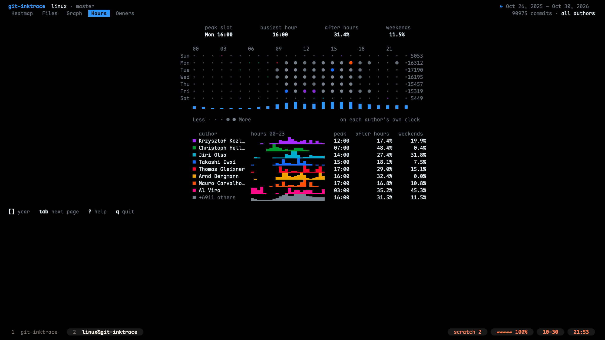
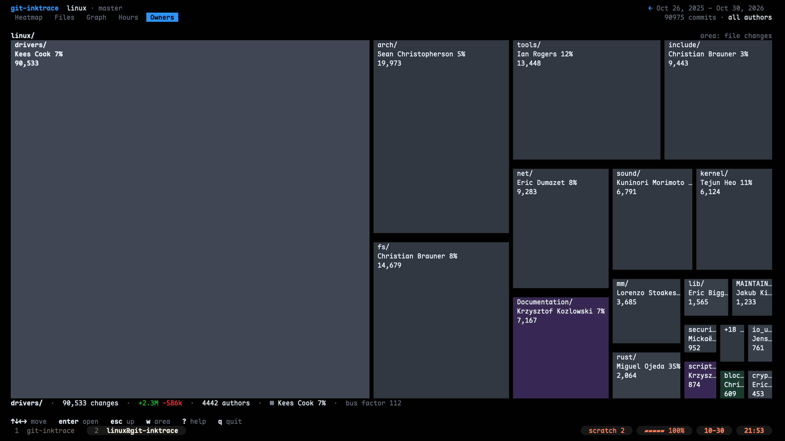

<h1 align="center">git-inktrace</h1>

<p align="center">Just for fun 🎨</p>

<p align="center">A terminal UI that shows who worked on a git repository, when, on which files, and how its branches grew.</p>

<p align="center">
  <a href="LICENSE"></a>
</p>

<p align="center">
  <a href="#usage">Usage</a> ·
  <a href="https://github.com/ZhiWei-Ou/git-inktrace/issues">Issues</a>
</p>

<p align="center">
  
</p>

## Features

- **Heatmap** — a GitHub-style calendar where each day takes the color of its busiest author, with a repository overview and each author's share of the month, the window and all history.
- **Files** — the files changed most often, with lines added and deleted and their top author; history follows renames.
- **Graph** — `git log --graph` with commits in their authors' colors; search, inspect, copy a hash or reword a message.
- **Hours** — a punch card of commits by weekday and hour on each author's own clock, plus everyone's daily rhythm.
- **Owners** — a treemap of the work tree colored by who changed each part most, with its bus factor.
- **Quick on big histories** — opens on commit headers at once and loads file changes in the background.

<table>
  <tr>
    <td></td>
    <td></td>
  </tr>
  <tr>
    <td></td>
    <td></td>
  </tr>
</table>

## Quick Start

Requires Go 1.26 or later, `git` and `make`.

```sh
git clone https://github.com/ZhiWei-Ou/git-inktrace.git
cd git-inktrace
make build
./bin/git-inktrace
```

It opens on the git-inktrace repository itself; `tab` switches pages and `q` quits. Copy `bin/git-inktrace` onto your `PATH` to run `git inktrace` in any repository.

## Usage

```text
git-inktrace [flags]

Flags:
  -C path        run as if started in path (default ".")
  -all           include every branch, remote branch and tag, not only HEAD (stashes excluded)
  -top int       number of files in the ranking, 0 for all (default 100)
  -version       print version and exit

Filter:
  -author names  show only authors whose name or email contains one of the names, separated by ';' (hides hours and owners)

Start page (pick one):
  -heatmap       open on the heatmap (default)
  -files         open on the file ranking
  -graph         open on the branch graph
  -hours         open on the punch card of commit hours
  -owners        open on the code ownership treemap
```

```sh
git inktrace -all                 # count every branch and tag
git inktrace -owners              # see who owns which part of the code
git inktrace -author 'alice;bob'  # only Alice's and Bob's commits
```

| Key | Action |
| --- | --- |
| `tab`, `1` – `5` | Switch pages |
| `[` `]`, `t` | Year back / forward, latest year |
| `↑` `↓` / `k` `j` | Select a file or commit; on Owners the arrows move between tiles |
| `enter`, `esc` | Inspect or open the selection, go back |
| `/`, `n` `N` | Search the graph, next / previous match |
| `?` | Every key, by page |
| `q` | Quit |

Authors are merged by email and name after `.mailmap`, like `git shortlog`. Merge commits are skipped. Rewording (`e` on the graph) is the only action that writes to the repository: it rewrites the current branch from that commit without touching the work tree, and asks first if the commit is already pushed.

## Contributing

Bug reports and ideas are welcome in [GitHub Issues](https://github.com/ZhiWei-Ou/git-inktrace/issues). Run `make check` before opening a pull request; `make help` lists the other build targets, including `make release` for every platform.

## License

[MIT](LICENSE)
